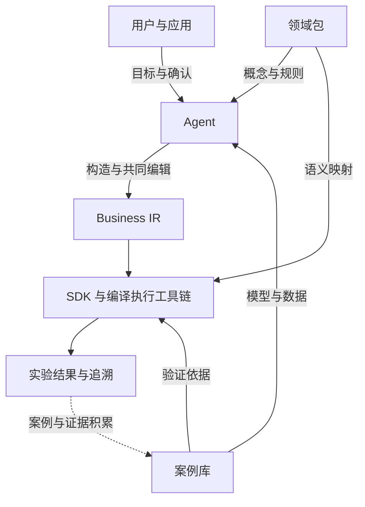
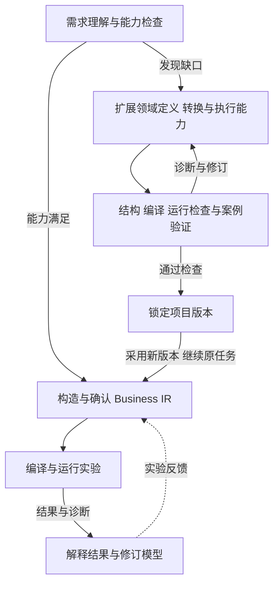

# 复杂系统建模与仿真白皮书
以多层 IR 建立可追溯的人机协作
2026-10-17 · 精炼版

> **首版范围：** 本文阐述长期架构与方向。当前插件的必需功能和完成标准以[功能需求与开发合同 v0.2](docs/functional-requirements-v0.2.md)为准。

## 1 人机共享的可执行模型

我们以多层中间表示（IR）连接自然语言需求、业务模型与仿真实验，让 LLM 的建模假设和决策成为可审阅、可修改、可执行的模型。

用户与 Agent 在同一份业务模型上协作：明确系统边界，定义对象、关系、规则和参数，确定实验目标。编译器将确认后的模型转化为执行计划，实验结果沿同一条链路返回模型与需求。

**核心贡献是建立从用户意图到仿真行为的可追溯对齐机制，让人确认的模型成为机器执行的依据。**

*图 1  用户、Agent 与工具链共享模型，领域包与案例库贯穿任务。*

### 明确分工的协作架构

Agent 理解需求、构造模型、处理诊断并解释结果。通用 SDK 负责加载领域包、查询能力、提交任务和管理产物。领域包提供业务概念与规则，编译器及运行时完成转换、优化与计算。案例库提供可复用模型、参考数据与验证证据。

## 2 从业务模型到仿真实验

多层 IR 将业务含义、仿真机制与执行安排分别表达，使人能够在熟悉的业务层修改模型，使工具链能够执行确定的转换与优化。

| 模型层 | 表达内容 | 主要作用 |
| --- | --- | --- |
| Business IR | 对象、关系、业务规则、约束与参数 | 供用户与 Agent 理解、编辑和确认 |
| Core Simulation IR | 状态、事件、过程、资源与时间 | 明确仿真语义，支持校验与转换 |
| Execution Plan | 数据布局、事件调度与后端操作 | 组织实际执行，支持专门化与性能优化 |

### 多种表达共享同一条编译链

Business IR 承载业务语义，可通过结构化文本、SysML 或流程块等形式呈现。领域包定义概念与规则的含义，语言适配器负责读取和映射。用户选择适合问题的表达方式，编译器按明确的映射规则生成 Core IR 和执行计划。

### 复用现有能力完成任务

1. **理解与选择**  用户与 Agent 澄清目标、约束和实验指标，选择领域包、能力配置与语言适配器。
2. **构造与确认**  Agent 组合 Business IR，引用案例与数据；用户审阅并修改规则、参数和实验设置。
3. **编译与实验**  Agent 经 SDK 提交模型，工具链完成校验、逐层转换和运行，记录模型版本与实验配置。
4. **解释与迭代**  Agent 解释结果与方案差异，用户据此调整模型，开展下一轮实验。

### 模型追溯与实验复现

每次实验绑定模型、领域包、编译器及运行配置。源映射连接业务元素、执行操作与运行事件，使诊断和结果能够回到对应规则。编译器利用模型结构进行预计算、索引化与专门化，将业务信息用于执行优化。

## 3 需求驱动的能力扩展

当需求超出现有能力，Agent 在当前任务中扩展领域定义、转换规则及所需执行能力。扩展完成后绑定新版本，重新进入建模与实验流程。

*图 2  复用与扩展组成同一条任务闭环，诊断和实验反馈驱动持续迭代。*

### 案例库贯穿建模与验证

建模时，案例库提供模型结构、参数和背景数据；扩展时，提供独立预期、边界用例和回归依据；实验后，接收带来源和版本的模型、数据与证据。Agent 根据新行为补充案例，验收工具执行比较与检查。独立预期与实际运行结果分别记录，形成可追溯的证据链。

### 探索建模与证据积累

面对新问题，用户与 Agent 通过结构、编译和运行检查建立项目内建模工具，开展方案比较与敏感性分析。实验记录呈现模型假设、参数和已有验证依据。随着数据与参考案例积累，模型逐步获得校准和验证，并沉淀为可共享的领域能力与案例资产。

### 以闭环成本衡量价值

系统围绕需求到模型的形成时间、人工修订成本、需求与执行的语义一致性、实验效率和资产复用程度评价效果，推动问题分析、模型修订、仿真实验与实际改进连续迭代。
